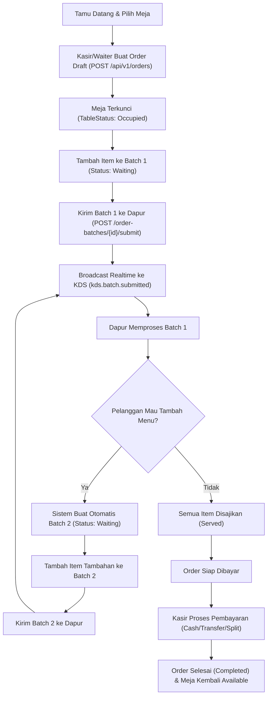
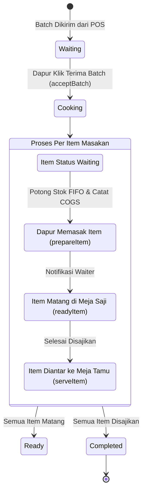
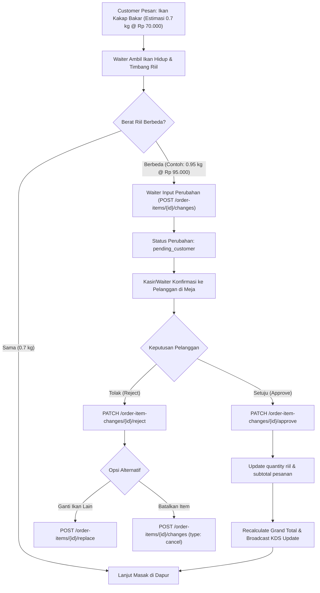

# Business Process Flow Diagrams

Dokumen ini memetakan alur proses bisnis operasional restoran seafood dari kedatangan pelanggan, pemesanan multi-batch, penanganan dapur KDS, timbangan dinamis ikan hidup, hingga kalkulasi HPP dan pembayaran kasir.

---

## 1. Siklus Hidup Pesanan (Order Lifecycle & Multi-Batch)

Pelanggan dapat melakukan pemesanan awal, kemudian menambah pesanan makanan/minuman kapan saja (Batch 2, 3, dst.) tanpa membatalkan atau mengganggu pesanan yang sudah dimasak di dapur.



---

## 2. Kitchen Display System (KDS Workflow)

Alur kerja staf dapur berbasis stasiun memasak (Grill, Fry, Wok, Drink, Steam):



---

## 3. Alur Bobot Seafood Hidup Dinamis (Dynamic Weight & Price Change)

Pada restoran seafood, ikan/kepiting/udang hidup ditimbang riil saat diambil dari kolam/pasar. Jika berat riil berbeda dari estimasi awal menu, perubahan bobot dan harga harus dikonfirmasi oleh pelanggan:



---

## 4. Alur Manajemen Stok FIFO & Kalkulasi HPP (COGS)

Setiap bahan baku yang masuk dicatat dalam *inventory batch* terpisah dengan tanggal terima dan harga modal beli masing-masing. Saat item diproses di dapur, sistem memotong stok menggunakan prinsip First-In First-Out:

```mermaid
flowchart LR
    subgraph Gudang Bahan Baku (Inventory Batches)
        B1["Batch 1 (Oldest): 5 kg @ Rp 20.000"]
        B2["Batch 2 (Newer): 5 kg @ Rp 30.000"]
    end

    subgraph Dapur Masak
        Req["Dapur Memasak Gurame 7 kg"]
    end

    Req --> Deduct1["Ambil Habis Batch 1: 5 kg x Rp 20.000 = Rp 100.000"]
    Deduct1 --> Deduct2["Ambil Sisa 2 kg dari Batch 2: 2 kg x Rp 30.000 = Rp 60.000"]
    
    Deduct2 --> Result["Total HPP (COGS): Rp 160.000"]
    Result --> ProfitCalc["Gross Profit = Penjualan (Rp 350.000) - HPP (Rp 160.000) = Rp 190.000"]
    ProfitCalc --> Rec["Tercatat Otomatis di stock_movements & order_items"]
```

