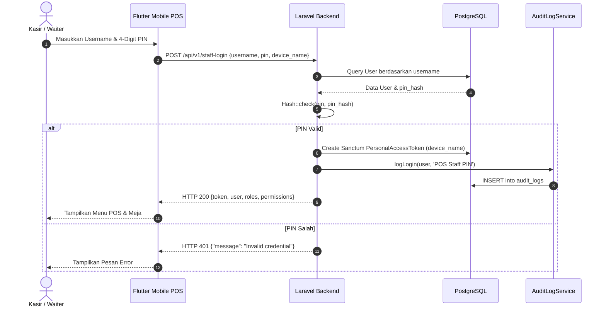
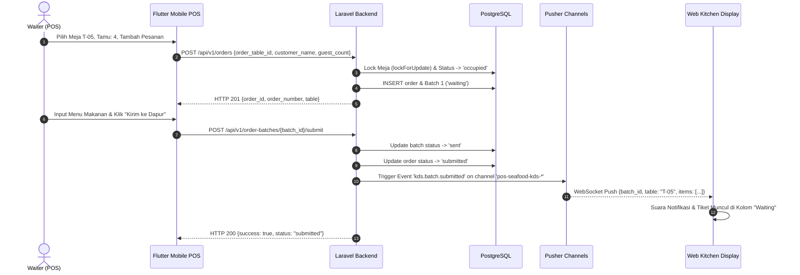
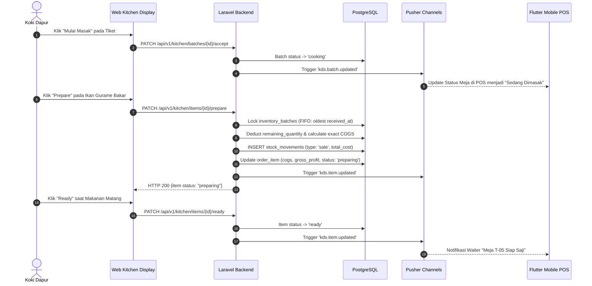
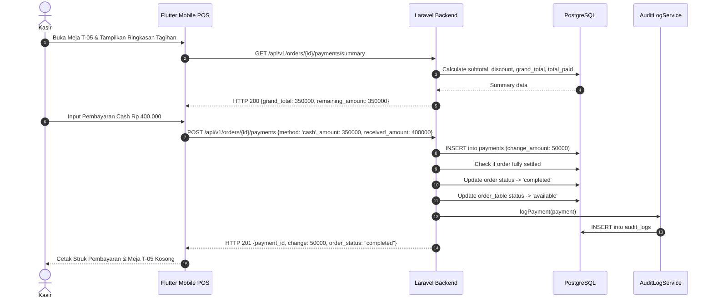

# Sequence Diagrams

Dokumen ini mendokumentasikan interaksi pertukaran pesan antar aktor dan sistem: Mobile POS (Flutter), Backend API (Laravel), WebSocket Broker (Pusher Channels), Web Kitchen Display System (KDS), dan Database (PostgreSQL).

---

## 1. Login & Autentikasi Pengguna (Web & POS Staff PIN)

---

## 2. Pembuatan Order & Broadcast Realtime ke Dapur (KDS)

---

## 3. Eksekusi Masakan di Dapur & Pemotongan FIFO Bahan Baku

---

## 4. Proses Pembayaran Kasir & Pelepasan Meja

