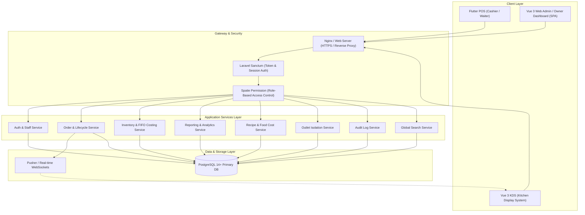

# Seafood Restaurant POS & Management System - Architecture Overview

## 1. High-Level Architecture

The system is designed as a modular, decoupled, and real-time Restaurant Management System (RMS) specifically engineered for high-turnover seafood restaurants.

---

## 2. Core Modules & Responsibilities

1. **Order Processing & Lifecycle**:
   - Manages table occupancy, dine-in / take-away orders, batch kitchen submissions.
   - Status states: `submitted` → `preparing` → `ready` → `completed` / `cancelled`.
   - Real-time events dispatched to Kitchen Display System (KDS).

2. **Inventory Management & FIFO Batch Costing**:
   - Multi-batch tracking with expiration, arrival dates, and unit costs.
   - Real-time stock depletion using First-In-First-Out (FIFO).
   - Direct seafood market replenishment fallback for uninterrupted kitchen operations.
   - Waste tracking with cost valuation and reason classification.

3. **Recipe Management & Food Cost Analysis**:
   - Bill of materials (BOM) linking menu variants with raw ingredients.
   - Automated COGS and food cost percentage calculation based on active inventory batch prices.
   - Gross margin and pricing recommendation tools.

4. **Multi-Outlet Support**:
   - Isolated inventory, orders, tables, and staff per outlet.
   - Centralized Owner dashboard with aggregated or branch-specific reporting.

5. **Security & Audit Logs**:
   - Strict role segregation (`owner`, `admin`, `cashier`, `kitchen`).
   - Audit trail capturing logins, order mutations, cash adjustments, stock movements, and system configuration changes.

6. **Global Fast Search**:
   - Multi-model indexed search covering Orders, Menus, Ingredients, Staff, Recipes, and Outlets.
   - Accessible from any admin page with keyboard shortcuts (`Ctrl + K`).

